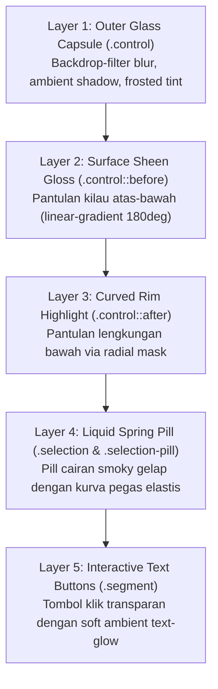

# Formula & Cetak Biru: Apple Liquid Glass Button

Dokumen ini berisi rumus, arsitektur layer, matematika CSS, serta template kode modular untuk membuat **iOS / macOS Liquid Glass Button (Segmented Control)** yang dapat Anda gunakan kembali di berbagai proyek web apa pun.

---

## 1. Konsep Arsitektur 5-Layer (Layer Stack)

Tombol ini tidak dibuat dari satu elemen CSS biasa, melainkan dari **5 lapisan optik bertumpuk** yang meniru pembiasan fisik kaca asli (*refraction, specular reflections, & fluid physics*):



---

## 2. Rumus Token Desain (CSS Variables)

Agar tombol ini mudah disesuaikan ukurannya (misal untuk navbar kecil `48px`, ukuran standar `64px`, atau ukuran hero `160px-200px`), gunakan formula variabel berikut:

```css
:root {
  /* Dimensi */
  --liquid-width: 380px;         /* Lebar total tombol */
  --liquid-height: 64px;          /* Tinggi total tombol */
  --liquid-padding: 6px;          /* Jarak dalam kapsul ke pill */
  --liquid-radius: 999px;         /* Bentuk kapsul penuh */

  /* Warna Tint Kaca (Disesuaikan dengan tema background) */
  --glass-tint-top: rgba(224, 248, 255, 0.16);
  --glass-tint-mid: rgba(126, 174, 188, 0.045);
  --glass-tint-bottom: rgba(235, 252, 255, 0.12);
  --glass-border: rgba(215, 242, 252, 0.32);

  /* Bahan Pill Aktif (Smoky Fluid) */
  --pill-bg-start: rgba(10, 28, 36, 0.62);
  --pill-bg-end: rgba(22, 48, 58, 0.38);

  /* Fisika Animasi */
  --spring-curve: cubic-bezier(0.34, 1.3, 0.38, 1);
  --spring-duration: 520ms;
}
```

---

## 3. Rahasia & Aturan Emas Efek Kaca Apple (Golden Rules)

1. **JANGAN gunakan garis datar (`height: 1px`) untuk highlight rim**:
   - Bentuk tombol adalah kapsul (`border-radius: 999px`).
   - Highlight yang melengkung harus selalu menggunakan `border-radius: inherit` yang dipadukan dengan `box-shadow: inset ...` atau `mask-image: radial-gradient(...)` agar tidak ada garis kaku yang menembus keluar lengkungan.
2. **Double Inset Shadow untuk Ketebalan Kaca (Bevel Effect)**:
   - Pantulan atas terang: `inset 0 1.5px 1.5px rgba(255,255,255,0.38)`.
   - Bayangan bawah gelap: `inset 0 -2px 3px rgba(8, 22, 28, 0.28)`.
   - Ketebalan tepi samping: `inset 1px 0 2px ...` dan `inset -1px 0 2px ...`.
3. **Efek Squash & Stretch (Tetesan Cairan)**:
   - Saat berpindah, pill tidak hanya meluncur datar, tapi meregang horizontal `scale(1.07, 0.94)` dan membal secara organik `scale(0.98, 1.02)`.
4. **Optimasi Performa Mobile (Anti-Lag 60/120fps)**:
   - Gunakan `transform: translate3d(0, 0, 0)` dan `backface-visibility: hidden`.
   - **Haram** menganimasikan `filter: blur()` berulang pada runtime di HP.
   - Pada layar kecil (`@media (max-width: 600px)`), turunkan blur menjadi `16px` untuk memangkas beban GPU hingga 70%.

---

## 4. Template Standalone Siap Pakai (Drop-in Component)

Anda dapat menyalin template independen ini ke proyek React, Vue, Next.js, Svelte, atau Vanilla HTML/CSS.

### HTML

```html
<div class="liquid-control" role="tablist" data-active="inbox">
  <!-- Liquid Indicator Pill -->
  <span class="liquid-selection" aria-hidden="true">
    <span class="liquid-pill"></span>
  </span>

  <!-- Segment Options -->
  <button 
    class="liquid-segment" 
    type="button" 
    role="tab" 
    data-value="inbox" 
    aria-selected="true"
  >
    Inbox
  </button>

  <button 
    class="liquid-segment" 
    type="button" 
    role="tab" 
    data-value="draft" 
    aria-selected="false"
  >
    Draft
  </button>
</div>
```

---

### CSS

```css
/* 1. Track Kaca Luar */
.liquid-control {
  position: relative;
  display: grid;
  grid-template-columns: 1fr 1fr;
  width: min(var(--liquid-width, 360px), calc(100vw - 32px));
  height: var(--liquid-height, 64px);
  padding: var(--liquid-padding, 6px);
  border-radius: var(--liquid-radius, 999px);
  border: 1px solid var(--glass-border, rgba(215, 242, 252, 0.32));

  background: linear-gradient(155deg,
    rgba(224, 248, 255, 0.16) 0%,
    rgba(126, 174, 188, 0.045) 36%,
    rgba(235, 252, 255, 0.12) 100%
  );

  box-shadow:
    0 24px 48px -12px rgba(4, 16, 22, 0.5),
    0 8px 16px -4px rgba(4, 16, 22, 0.3),
    inset 0 1.5px 1.5px rgba(255, 255, 255, 0.38),
    inset 0 0.5px 0.5px rgba(255, 255, 255, 0.65),
    inset 0 -2px 3px rgba(8, 22, 28, 0.28),
    inset 1px 0 2px rgba(229, 251, 255, 0.22),
    inset -1px 0 2px rgba(229, 251, 255, 0.2);

  backdrop-filter: blur(28px) saturate(155%) brightness(1.03);
  -webkit-backdrop-filter: blur(28px) saturate(155%) brightness(1.03);

  cursor: pointer;
  user-select: none;
  -webkit-tap-highlight-color: transparent;
  -webkit-transform: translate3d(0, 0, 0);
  transform: translate3d(0, 0, 0);
}

/* 2. Pantulan Kilau Permukaan Kaca Atas-Bawah */
.liquid-control::before {
  content: "";
  position: absolute;
  inset: 2px;
  border-radius: inherit;
  pointer-events: none;
  background: linear-gradient(180deg,
    rgba(240, 252, 255, 0.18) 0%,
    rgba(240, 252, 255, 0.05) 18%,
    transparent 55%,
    rgba(215, 248, 255, 0.14) 100%
  );
  box-shadow:
    inset 0 1px 1px rgba(245, 253, 255, 0.3),
    inset 0 -1px 1px rgba(235, 253, 255, 0.2);
}

/* 3. Pantulan Rim Bawah Melengkung */
.liquid-control::after {
  content: "";
  position: absolute;
  inset: 0;
  border-radius: inherit;
  pointer-events: none;
  box-shadow: inset 0 -2px 3.5px rgba(225, 252, 255, 0.7);
  mask-image: radial-gradient(ellipse 70% 40% at 50% 100%, black 20%, transparent 75%);
  -webkit-mask-image: radial-gradient(ellipse 70% 40% at 50% 100%, black 20%, transparent 75%);
}

/* 4. Sliding Indicator Container */
.liquid-selection {
  position: absolute;
  z-index: 0;
  top: var(--liquid-padding, 6px);
  bottom: var(--liquid-padding, 6px);
  left: var(--liquid-padding, 6px);
  width: calc(50% - var(--liquid-padding, 6px));
  border-radius: inherit;
  pointer-events: none;
  will-change: transform;
  -webkit-transform: translate3d(0, 0, 0);
  transform: translate3d(0, 0, 0);
  transition: transform 520ms cubic-bezier(0.34, 1.3, 0.38, 1);
}

/* Posisi Tab ke-2 (Draft) */
.liquid-control[data-active="draft"] .liquid-selection {
  transform: translate3d(100%, 0, 0);
}

/* 5. Pill Cairan Smoky Gelap */
.liquid-pill {
  position: relative;
  display: block;
  width: 100%;
  height: 100%;
  border-radius: inherit;
  overflow: hidden;

  background: linear-gradient(155deg,
    rgba(10, 28, 36, 0.62) 0%,
    rgba(18, 42, 52, 0.48) 55%,
    rgba(22, 48, 58, 0.38) 100%
  );

  box-shadow:
    inset 0 1px 1px rgba(230, 250, 255, 0.32),
    inset 0 2.5px 6px rgba(0, 0, 0, 0.42),
    inset 0 1px 2px rgba(0, 0, 0, 0.3),
    inset 0 -1px 1px rgba(215, 245, 255, 0.12),
    0 1px 2px rgba(235, 252, 255, 0.05);

  transition: transform 300ms cubic-bezier(0.2, 0.9, 0.3, 1);
  will-change: transform;
}

/* Kilau Volumetrik Melengkung pada Atas Pill */
.liquid-pill::before {
  content: "";
  position: absolute;
  inset: 0;
  border-radius: inherit;
  pointer-events: none;
  background: radial-gradient(
    ellipse 85% 45% at 50% 0%,
    rgba(225, 248, 255, 0.22) 0%,
    transparent 70%
  );
}

/* Tactile Press (Squish saat diklik) */
.liquid-control:active .liquid-pill {
  transform: scale(0.96, 0.94);
}

/* Animasi Squash & Stretch saat meluncur */
.liquid-control.is-animating .liquid-pill {
  animation: liquidStretch 520ms cubic-bezier(0.25, 1, 0.35, 1);
}

@keyframes liquidStretch {
  0% { transform: scale(1, 1); }
  35% { transform: scale(1.07, 0.94); }
  65% { transform: scale(0.98, 1.02); }
  85% { transform: scale(1.01, 0.99); }
  100% { transform: scale(1, 1); }
}

/* 6. Tombol Teks Segmen */
.liquid-segment {
  position: relative;
  z-index: 1;
  display: grid;
  place-items: center;
  padding: 0;
  border: 0;
  border-radius: 999px;
  background: transparent;

  color: rgba(212, 232, 240, 0.5);
  font-family: -apple-system, BlinkMacSystemFont, "SF Pro Display", sans-serif;
  font-size: clamp(16px, 2.5vw, 20px);
  font-weight: 500;
  letter-spacing: -0.02em;
  cursor: pointer;
  outline: none;

  transition:
    color 340ms cubic-bezier(0.25, 1, 0.5, 1),
    text-shadow 340ms cubic-bezier(0.25, 1, 0.5, 1),
    transform 360ms cubic-bezier(0.34, 1.25, 0.38, 1);
}

.liquid-segment:hover {
  color: rgba(235, 248, 255, 0.78);
}

.liquid-segment[aria-selected="true"] {
  color: rgba(255, 255, 255, 0.98);
  transform: scale(1.02);
  text-shadow:
    0 1px 16px rgba(255, 255, 255, 0.28),
    0 1px 2px rgba(4, 16, 22, 0.4);
}

/* 7. Optimasi Khusus Mobile (Mencegah Frame Drop) */
@media (max-width: 600px) {
  .liquid-control {
    backdrop-filter: blur(16px);
    -webkit-backdrop-filter: blur(16px);
    box-shadow:
      0 16px 32px -8px rgba(4, 16, 22, 0.45),
      0 4px 8px rgba(4, 16, 22, 0.2),
      inset 0 1px 1px rgba(255, 255, 255, 0.4),
      inset 0 -1.5px 2px rgba(8, 22, 28, 0.25);
  }
}
```

---

### JavaScript

```javascript
function initLiquidControl(selector = ".liquid-control", onTabChange = null) {
  const controls = document.querySelectorAll(selector);

  controls.forEach((control) => {
    const buttons = [...control.querySelectorAll(".liquid-segment")];

    buttons.forEach((button) => {
      button.addEventListener("click", () => {
        const value = button.dataset.value;
        if (control.dataset.active === value) return;

        // Picu reflow agar animasi stretch bisa diputar ulang saat diklik cepat
        control.classList.remove("is-animating");
        void control.offsetWidth;
        control.classList.add("is-animating");

        control.dataset.active = value;

        // Perbarui atribut aksesibilitas
        buttons.forEach((item) => {
          const isSelected = item === button;
          item.setAttribute("aria-selected", String(isSelected));
        });

        // Callback opsional jika ingin mengubah konten halaman
        if (typeof onTabChange === "function") {
          onTabChange(value);
        }

        setTimeout(() => {
          control.classList.remove("is-animating");
        }, 540);
      });
    });
  });
}

// Inisialisasi
document.addEventListener("DOMContentLoaded", () => {
  initLiquidControl(".liquid-control", (activeTab) => {
    console.log("Tab aktif berganti ke:", activeTab);
  });
});
```

---

## 5. Cara Menyesuaikan untuk 3 Opsi atau Lebih

Jika di masa depan Anda ingin membuat segmented control dengan **3 opsi** (misal: `Inbox`, `Draft`, `Sent`):

1. **Ubah Grid Track**:
   ```css
   .liquid-control {
     grid-template-columns: repeat(3, 1fr);
   }
   ```
2. **Ubah Lebar Selection**:
   ```css
   .liquid-selection {
     width: calc((100% - (var(--liquid-padding) * 2)) / 3);
   }
   ```
3. **Ubah Transform Nilai Tab**:
   ```css
   .liquid-control[data-active="inbox"] .liquid-selection { transform: translate3d(0%, 0, 0); }
   .liquid-control[data-active="draft"] .liquid-selection { transform: translate3d(100%, 0, 0); }
   .liquid-control[data-active="sent"]  .liquid-selection { transform: translate3d(200%, 0, 0); }
   ```
